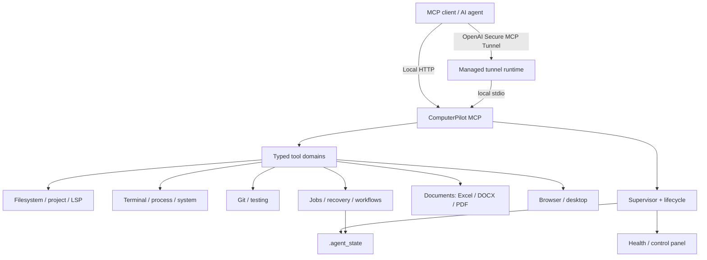

# ComputerPilot MCP

**Supervised computer use and developer automation over the Model Context Protocol.**

Current source includes the **cross-platform runtime-hardening integration** validated on Linux and Windows and covered by hosted Linux, macOS, and Windows CI. The latest published release remains **0.9.0** ([release notes](docs/V0.9.0-RELEASE-NOTES.md), [validation](docs/V0.9.0-VALIDATION.md)); the hardening work described here is unreleased and no new version or tag is implied. Optional capabilities keep their documented defaults and require operator configuration.

[](https://github.com/dibbed/computerpilot-mcp/releases/latest)
[](https://github.com/dibbed/computerpilot-mcp/actions/workflows/ci.yml)
[](https://github.com/dibbed/computerpilot-mcp/actions/workflows/platform-validation.yml)
[](https://www.python.org/)
[](LICENSE)

ComputerPilot MCP gives MCP-capable AI agents a local runtime for **files, native document intelligence, terminal and process execution, Git, testing, code intelligence, browser automation, durable jobs, crash recovery, and multi-step workflows**. On Windows it also exposes native screenshots, input, and semantic UI Automation.

It is designed for developers who want an agent to do real work on a machine without collapsing everything into one unstructured shell tool. Capabilities are exposed as typed MCP tools, platform-specific features are registered only when supported, long-running work can survive MCP restarts, and ambiguous mutations are never replayed blindly.

> **Security:** this project intentionally has broad local capabilities. Treat access to the MCP endpoint as equivalent to granting a development agent access to the OS account running it. See [SECURITY.md](SECURITY.md).

## Cross-Platform Validation

ComputerPilot MCP has been tested with its **full automated suite and representative real MCP integrations on both Linux and Windows**. macOS passes the same hosted CI matrix and the Platform Release Validation gate; native interactive macOS desktop acceptance is not claimed.

| Capability / validation | Linux amd64 | Windows amd64 | macOS |
| --- | --- | --- | --- |
| Automated CI (Python 3.10 and 3.12) | Verified | Verified | Verified |
| Platform Release Validation | Verified | Verified | Verified |
| Native terminal execution | Verified (`run_shell`, `run_process`) | Verified (CMD, PowerShell, `run_process`) | Hosted CI coverage |
| Process cancellation and recovery | Verified | Verified | Hosted CI coverage |
| SQLite schema/migration tests | Verified | Verified | Hosted CI coverage |
| Real Chromium acceptance (local fixture) | Verified | Verified | Not independently verified |
| Real Pyright language-server acceptance | Verified | Verified | Not independently verified |
| Windows UI Automation | Not applicable | Verified with isolated fixture | Not applicable |
| Sustained bounded MCP soak | Verified (181 s) | Verified (181 s) | Not independently verified |
| Full automated regression suite (hosted CI at `c33004e`) | 2,516 passed, 24 skipped | 2,526 passed, 14 skipped | 2,516 passed, 24 skipped |

At `c33004e`, hosted CI reported the counts above. A local Windows grouped acceptance run recorded **2,505 passed, 35 skipped, 0 failed** across 160 test files, and a final ungrouped local run after the Pyright launcher fix recorded **2,508 passed, 35 skipped, 0 failed**; the difference from hosted counts is mostly symlink-privilege skips on the local host. The final integration adds three Pyright launcher regression tests, so its own hosted logs are the authority for updated totals. Counts also vary by platform and selection. The Linux and macOS suites exercised real MCP stdio/HTTP sessions, POSIX process ownership and cancellation, stale-claim reconciliation, durable jobs/workflows, schema v12 migration coverage, Chromium, Pyright and a multi-minute live MCP soak. Windows native acceptance additionally covered Job Objects, CMD/PowerShell, process-tree cleanup, UI Automation, browser uploads/downloads and an isolated 181-second resource soak.

Linux provides the portable ComputerPilot tool catalog and full authorized operating-system capabilities (files, terminal, Git, testing, documents, browser, jobs, recovery and workflows). Windows-only UI Automation tools are not registered on Linux or macOS. Hosted macOS results validate portable functionality; they do not establish that every interactive or hardware-dependent workflow was tested on a native Mac.

Evidence:

- [Cross-platform runtime hardening report](docs/CROSS-PLATFORM-RUNTIME-HARDENING-REPORT.md)
- [Windows native acceptance report](docs/WINDOWS-NATIVE-ACCEPTANCE-REPORT.md)
- [Linux deep integration audit](docs/LINUX-DEEP-INTEGRATION-AUDIT.md)
- [Linux reliability hardening report](docs/LINUX-RELIABILITY-HARDENING-REPORT.md)
- [CI run 42442780885](https://github.com/dibbed/computerpilot-mcp/actions/runs/42442780885) and [Platform Validation run 42442780796](https://github.com/dibbed/computerpilot-mcp/actions/runs/42442780796) at `c33004e`
- [CI workflow](.github/workflows/ci.yml) and [Platform Validation workflow](.github/workflows/platform-validation.yml)

Those runs validated `c33004e`; later commits require their own hosted results. Detailed measurements and known gaps stay in the reports rather than being presented as universal guarantees.

## Why ComputerPilot MCP

- **One supervised runtime for coding and computer use.** Files, code search, LSP, Git, diagnostics, processes, browser automation, jobs, workflows, recovery, and system inspection share one MCP surface.
- **Durable instead of request-bound.** Long-running commands can use persistent jobs with idempotency keys, bounded concurrency, cancellation, incremental output, and restart survival.
- **Recovery is explicit.** Interrupted mutations can become uncertain and require evidence-based reconciliation or operator acknowledgement instead of blind replay.
- **Cross-platform core, capability-gated edges.** Windows, Linux, and macOS share the portable core; native Windows desktop/UI Automation is only registered on supported hosts.
- **Verified remote tunnel bootstrap.** Tunnel mode downloads the official OpenAI Secure MCP Tunnel runtime into local state and verifies release metadata, checksums, and binary version before publication.
- **Release evidence is reproducible.** CI, platform validation, deterministic packaging, checksums, Doctor checks, benchmarks, and release validation live in the repository.

## Security Model

ComputerPilot is a **full-capability** local automation runtime, not an OS sandbox. Access to the MCP endpoint is equivalent to granting the connected agent the local permissions of the account that runs the server.

- Run the server only under an account whose filesystem, process and desktop access match what you intend to delegate.
- The local HTTP endpoint and control panel bind to loopback by default; do not expose them directly to untrusted networks. Use the managed Secure Tunnel path for remote access and protect its credentials.
- Arbitrary terminal commands are conservatively coordinated as **exclusive**. `access="read"` remains a wire-compatibility hint; it does not make arbitrary shell code safe to run concurrently. Native typed readers retain read concurrency.
- Cancellation operation IDs are process-local **bearer capabilities**, not client authentication. They are not persisted, and durable audit records store only a keyed correlation rather than the raw ID.
- Uncertain external side effects are not replayed blindly. Durable jobs use their own cancellation contract and are not cancelled by `cancel_operation`.
- External extensions and language providers run with the server account's permissions. Minimal environments, hashes, process ownership and filters reduce risk but do not create an OS sandbox.

See [SECURITY.md](SECURITY.md) for reporting, the local authority model and operational guidance.

## Quick Start

The fastest way to try the project without tunnel credentials is loopback-only local HTTP mode.

Requirements: Python 3.10 or newer, Git, and `sh` on Linux/macOS. Browser automation and LSP intelligence have separate optional dependencies.

### Windows

```powershell
git clone https://github.com/dibbed/computerpilot-mcp.git
Set-Location computerpilot-mcp
$env:MCP_START_MODE = "local-http"
.\START_MCP.bat
```

### Linux / macOS

```sh
git clone https://github.com/dibbed/computerpilot-mcp.git
cd computerpilot-mcp
MCP_START_MODE=local-http ./start_mcp.sh
```

If executable mode was lost while copying files on POSIX:

```sh
chmod +x start_mcp.sh
```

The launchers create or reuse `.venv`, validate Python and dependencies, run cached/full startup checks, and start the supervisor.

- MCP endpoint: `http://127.0.0.1:8765/mcp`
- Local control panel: `http://127.0.0.1:8766/`

For Secure Tunnel mode, browser setup, language-server configuration, release archives, and platform-specific notes, see [Installation](docs/installation.md).

## What You Can Do

| Area | Capabilities |
| --- | --- |
| Files & editing | bounded reads, search, atomic writes, exact/anchored edits, AST symbol-body edits, transactional unified patches, rollback-capable refactors |
| Code intelligence | project summaries, Python AST metadata, dependency graphs, consolidated code context, LSP definition/references/symbols/hover/call hierarchy/diagnostics |
| Git & verification | status/diff/show/blame/merge-base, guarded branch/stage/commit/restore, affected-test selection, pytest, Ruff, mypy, change-aware verification |
| Terminal & processes | native process execution, background processes, durable jobs, Windows CMD, PowerShell where available, POSIX shell on Linux/macOS; arbitrary commands take exclusive coordination, while typed native readers retain read concurrency |
| Documents | native XLSX/XLSM inspection and guarded edits, DOCX inspection/search/conservative mutation, bounded PDF metadata/text extraction, deterministic text/Markdown PDF creation |
| Browser | Playwright sessions, bounded semantic snapshots/queries, generation-scoped refs, semantic click/fill/select/waits, tabs, extraction, controlled upload/download, screenshots, isolated contexts, shared compatible browser processes, bounded shutdown and idle cleanup |
| Windows desktop | native screenshots, mouse/keyboard input, semantic UI Automation with bounded locators |
| Recovery & workflows | mutation journal, evidence-based reconciliation, durable workflow plans, optimistic versions, leases, restart recovery, bounded retries, stale-claim reconciliation |
| Adaptive execution routing | deterministic route candidates/recommendations across native, semantic, and explicitly allowed raw-desktop paths; hard safety constraints and explainable policy metadata |
| Operations | CPU/memory/disk/process/service/software inspection, health/resource budgets, local control panel, supervised restart/stop |
| Project memory | bounded versioned records with provenance and optimistic revisions |
| Secure Tunnel | verified managed runtime download/update, pinning, checksums, version validation, managed offline cache |

See [Tooling and workflows](docs/tooling.md) for the public tool model and practical examples.

## Architecture



Key runtime invariants:

- local HTTP and the control panel bind to loopback by default;
- filesystem mutations use scoped locks and guarded edit primitives;
- durable jobs keep persistent state and disk-backed output;
- uncertain side effects are not automatically replayed;
- arbitrary terminal commands are coordinated exclusively because arbitrary code cannot be proven read-only; `access="read"` is a compatibility hint, not a concurrency grant;
- Windows process ownership uses Job Objects, while POSIX uses sessions/process groups, with bounded cancellation and stale-claim reconciliation;
- browser sessions use isolated contexts with bounded pool/session lifetimes; the shared browser manager is drained and Playwright is stopped when the last server lifetime ends;
- language servers run under native process ownership with a minimal environment; the Node runtime directory is added only for known launcher dependencies such as the pip `pyright-langserver` wrapper;
- document mutations use scoped same-file locks, optional SHA-256 preconditions, staged validation, backups, atomic publication, and durable file-hash recovery checkpoints;
- generated runtime state lives under `.agent_state/` and is excluded from Git.

A deeper component map is in [Architecture](docs/architecture.md).

The opt-in `native_read_batch` tool reduces multiple independent file-window requests to one call. The 2026-10-28 quiet local single-file gate and [real GPT/Tunnel acceptance](docs/development/NATIVE-READ-BATCH-LIVE-ACCEPTANCE-2026-10-28.md) passed: N16 p95 fell 83.37% against direct parallel reads on the measured connection. A loaded stdio run exceeded the local target, so this is not a universal load guarantee. Keep `read_file` for a single file. See [batch limits and measured results](docs/tooling.md#opt-in-native-read-batching).

## Platform Support

| Platform | Release label | Validation status | Native desktop / UIA | Notes |
| --- | --- | --- | --- | --- |
| Windows amd64 | Supported | CI + Platform Validation + native interactive acceptance | Yes | Full portable core plus Windows desktop capabilities; 152-tool full profile observed |
| Linux amd64 | Preview | CI + Platform Validation + native Linux acceptance | No | Portable filesystem/documents/terminal/browser/Git/testing/jobs/recovery/workflows; 138-tool POSIX full profile observed |
| macOS arm64 | Preview | CI + Platform Validation | No | Portable core; browser is the UI automation path; native interactive acceptance not claimed |
| Linux arm64 | Preview package target | Packaging/updater mapping | No | No dedicated hosted-runner execution claimed |
| macOS amd64 | Preview package target | Packaging/updater mapping | No | No dedicated hosted-runner execution claimed |

The release workflow builds five target archives from the same tracked source. Linux and macOS remain labeled **Preview** because the project does not claim exhaustive coverage of every distribution, desktop environment, interactive workflow, or architecture. The portable tool catalog and full authorized OS capabilities are supported on Linux; Windows-only UI Automation is not emulated there. Platform claims and limitations are documented in [Platform support](docs/platform-support.md).

## Practical Agent Workflows

### Inspect → change → verify

```text
code_context
    ↓
apply_patch / rename_symbol / replace_exact
    ↓
affected_tests
    ↓
verify_changes
```

### Run a long task without tying it to one MCP request

```text
submit_job
    ↓
job_wait
    ↓
job_output
    ↓
cancel_job (when needed)
```

### Recover an interrupted mutation

```text
list_uncertain_operations
    ↓
inspect_uncertain_operation
    ↓
reconcile_operation
    ↓
acknowledge_uncertain_operation (only when evidence cannot resolve it)
```

### Durable multi-step automation

```text
workflow_plan
    ↓
workflow_start
    ↓
workflow_execute
    ↓
workflow_status / workflow_operations
    ↓
workflow_reconcile when a side effect is uncertain
```

Built-in workflows include `implement_and_verify`, `safe_git_commit`, and `prepare_release`. They do not push, tag, or deploy automatically.

## Tool Profiles

The default `full` profile preserves the complete catalog. Smaller profiles reduce the active domain set for specialized agents:

`minimal`, `coding`, `coding_core`, `read_batch`, `git`, `testing`, `documents`, `desktop`, `browser`, `operations`, `full`.

The opt-in `coding_core` keeps an exact 43-tool native coding catalog for a client that lists tools once. It includes guarded file/LSP edits, verification, Git, recovery and job observation; extensions need explicit profile eligibility. Its static SDK journey is tested, while the separately budgeted live-model UX pilot remains unverified. It does not change the default. See the [profile contract](docs/tooling.md#profiles).

The separate opt-in `read_batch` profile exposes bounded reads for independent local files in one MCP call. It does not provide an atomic multi-file snapshot or guarantee a local speedup; see [native read batching](docs/tooling.md#opt-in-native-read-batching).

The coding evolution plan still has open acceptance gates, including the separately controlled live-model comparison. The file-only Batch feature passed its quiet local and real GPT/Tunnel acceptance; contention limits remain documented. Optional grounding, delegation and related extensions retain their separate design gates. The [reviewed plan snapshot](docs/development/CODING-AGENT-EVOLUTION-MASTER-PLAN-SNAPSHOT.fa.md) is historical; current release scope and evidence are in the [0.9.0 notes](docs/V0.9.0-RELEASE-NOTES.md) and [validation](docs/V0.9.0-VALIDATION.md).

`discover_tool_domains` reports the current profile and platform capabilities. `recommend_tools` ranks tools that are actually registered in the active profile and enriches recognized tools with shared execution-route metadata. The read-only `execution_candidates` and `execution_recommend` diagnostics use that same registered catalog; metadata alone cannot make an unavailable tool routable.

Set a profile with:

```text
MCP_TOOL_PROFILE=coding
```

Set the variable before startup and restart the runtime to change profiles. `coding` omits browser, desktop/UIA, and native document tools. Keep `full` for mixed coding, desktop, and document work; `documents` includes filesystem, native documents, recovery, and workflows. A smaller catalog saves serialized discovery bytes by removing capabilities; it does not establish a model-token or task-quality improvement.

Profiles filter registration. They do not grant execution permission or implicitly enable extensions; typed tools and external operator policy retain their existing execution checks.

## Adaptive Execution Routing

The routing layer introduced in v0.7 is a **decision layer**, not a universal dispatcher. It receives a structured intent, generates candidates only from tools registered in the active MCP profile, filters platform/capability and safety constraints, and applies the versioned deterministic policy `deterministic-v1`.

Initial route classes are:

- native: filesystem, code/LSP, Git, process, system, Excel, DOCX, and PDF;
- semantic: browser and Windows UI Automation;
- `raw.desktop`, only when the request explicitly permits raw desktop fallback and the action is not destructive;
- `visual.desktop`, reserved for a later visual-grounding phase and unavailable in v0.9.

The public diagnostics are read-only:

```text
execution_candidates
execution_recommend
```

There is intentionally no `execution_run` or hidden arbitrary-action dispatcher. Hard constraints run before ranking: unsupported platform/profile routes are excluded, stale semantic references never degrade to coordinates, destructive ambiguous semantic targets fail closed, destructive raw-desktop fallback is forbidden, and fidelity requirements such as Excel macro preservation cannot be overridden by ranking.

A workflow step may optionally persist a bounded `execution_intent`. Its selected route, router policy version, compact decision metadata, and bounded fallback history are stored before the side effect begins. If an operation becomes uncertain, the existing evidence/reconciliation path remains authoritative; the router does not blindly reroute and replay it.

Router configuration:

```text
MCP_EXECUTION_ROUTER_ENABLED=1
MCP_EXECUTION_ROUTER_POLICY=deterministic-v1
MCP_EXECUTION_ROUTER_EXPLAIN=1
```

Runtime health and the loopback Control Panel expose bounded route distribution, fallback/no-route counts, native/semantic/raw usage, latency, and recent decisions without storing raw prompts, document contents, screenshots, credentials, or secrets.

## Secure Tunnel Mode

Tunnel mode is the default launcher mode. It requires a control-plane API key. A profile can be supplied explicitly or resolved by the runtime configuration.

Recommended secret file:

```text
.secrets/control_plane_api_key.txt
```

Or set the key in the environment:

```powershell
$env:CONTROL_PLANE_API_KEY = "<your-key>"
.\START_MCP.bat
```

The project does **not** vendor tunnel-client or Cloudflared executables in Git or release archives. The managed updater downloads the matching official `openai/tunnel-client` runtime, validates the GitHub asset digest and upstream `SHA256SUMS.txt`, verifies the reported version, and publishes the selected runtime under `.agent_state/tunnel-runtime/`.

See [Binary provenance](BINARY_PROVENANCE.md).

## Browser Automation

Browser tools are optional.

```sh
python -m pip install -r requirements-browser.txt
python -m playwright install chromium
python -m scripts.doctor --mode local-http --browser
```

Playwright sessions use isolated contexts. Compatible sessions can share a browser process, and idle sessions/pools are bounded by runtime budgets. When the last MCP server lifetime ends, the shared browser manager fences new work, drains sessions and pools, and stops the Playwright driver; incomplete cleanup stays fenced and is retried before reuse.

Real Chromium acceptance on Linux and Windows covered semantic snapshots, fill/select/click, extraction, context isolation, uploads, downloads and shutdown with no remaining browser process. Public-site behavior, browser crash recovery and live idle-eviction timing are not universal guarantees.

The semantic browser layer prefers accessible meaning over raw selectors or coordinates:

```text
browser_open_page
    ↓
browser_snapshot / browser_query
    ↓
browser_click_semantic / browser_fill_semantic / browser_select
    ↓
browser_wait_for
```

Snapshot node refs are generation-scoped. Navigation, semantic mutations, or tab changes invalidate old refs, so stale targets fail closed instead of silently acting on a changed page. `browser_extract` returns bounded text, links, tables, form fields, or a selected subtree. Uploads require an explicit local file, and downloads are saved under controlled runtime storage with filename sanitization and a configured byte limit.

## Language Intelligence (LSP)

The seven read-only LSP tools default to a trusted discovered `pyright-langserver --stdio`. ComputerPilot does not install a language server automatically and never accepts an arbitrary language-server command from an MCP caller.

Install Pyright with the operator's normal tooling, for example:

```sh
python -m pip install pyright
# or, for a bundled Node runtime:
python -m pip install "pyright[nodejs]"
```

The pip Pyright launcher resolves Node through `PATH`. ComputerPilot's provider environment is deliberately minimal, but it adds the discovered Node directory for the Pyright launcher so the supported pip route works without inheriting the rest of the parent environment. If neither a system Node runtime nor the optional bundled `nodejs` wheel is available, install one of them; see [Troubleshooting](docs/troubleshooting.md#lsp-tools-cannot-start).

Real Pyright acceptance covered cross-file definitions, references, pull diagnostics, on-disk edit synchronization, restart and owned process cleanup on Linux and Windows. Opt-in persistent sessions use reviewed provider configuration (`MCP_LSP_PERSISTENT_ENABLED`, `MCP_LSP_PROVIDERS_CONFIG`); listing, health and catalog construction never launch a provider. Other providers and real-provider macOS execution remain unverified; see [provider configuration](docs/configuration.md#persistent-language-providers) and [tooling](docs/tooling.md#profiles).

## Native Document Intelligence

The portable `documents` domain works directly with files and does not launch Microsoft Office or another GUI.

Excel tools support `.xlsx` and `.xlsm` inspection, sheet/range reads, bounded search, formulas, tables, range writes/clears, and guarded sheet/table mutations. Macro-enabled workbooks are mutated only when the staged output preserves the VBA project bytes exactly; an `.xlsx` file that unexpectedly contains VBA is rejected instead of risking macro loss.

DOCX tools support structure/metadata inspection, bounded paragraph/table-cell reads and search, conservative text replacement, paragraph insertion, simple table-cell replacement, and simple document creation. `.docm`, tracked changes, comments, headers/footers, arbitrary WordprocessingML edits, and ambiguous mixed-format replacements are intentionally unsupported.

PDF tools support metadata/page inspection, bounded text extraction with inline or file-backed delivery, and deterministic creation from plain text or a documented Markdown subset. They do not provide arbitrary existing-PDF editing. Encrypted PDFs can be inspected for encryption state, but text extraction requires a decrypted input.

Document mutations share the recovery model: same-file writes are serialized, unrelated files can proceed independently, optional SHA-256 preconditions reject stale writes, output is staged and validated before atomic publication, backups are retained by the existing backup policy, and the expected final file hash is checkpointed durably before replacement.

## Local State

Generated machine-local state is kept out of Git.

| Path | Purpose |
| --- | --- |
| `.agent_state/jobs.sqlite3` + `.agent_state/jobs/` | durable job state and output |
| `.agent_state/workflows.sqlite3` | durable workflow definitions, operations, leases, and events |
| `.agent_state/artifacts/` | file-backed output |
| `.agent_state/backups/` | recoverable edit backups |
| `.agent_state/screenshots/` | browser/desktop screenshots |
| `.agent_state/browser_downloads/` | controlled browser downloads |
| `.agent_state/document_locks/` | cross-process coordination tokens for document mutations |
| `.agent_state/search_snapshots/` | bounded search continuation snapshots |
| `.agent_state/tunnel-runtime/` | verified managed Secure Tunnel runtime |
| `.agent_state/audit.jsonl` | metadata-oriented audit trail |
| `.agent_state/operation-recovery.jsonl` | standalone mutation recovery metadata |
| `memory/` | bounded project-memory records; generated JSON records are ignored |

Never commit `.agent_state/`, `.secrets/`, `.venv/`, logs, local databases, or generated output.

## Validation and Quality Gates

The repository's normal CI matrix runs on Windows, Linux, and macOS with Python 3.10 and 3.12. Each job installs development dependencies and runs:

- compileall;
- Ruff;
- mypy;
- MCP startup check;
- MCP health smoke;
- the full pytest suite.

**Platform Release Validation** runs on Windows, Linux, and macOS with Python 3.12. It executes the launcher and Full Doctor gates, startup/catalog checks, the benchmark, and a multi-workflow restart soak. **Release Packaging Smoke** builds all five archives and validates `SHA256SUMS.txt`.

Cross-platform hardening evidence:

- Linux: hosted CI (**2,516 passed, 24 skipped** at `c33004e`), real MCP stdio/HTTP integration, POSIX cancellation and process-tree recovery, runtime claim reconciliation, real Chromium and Pyright acceptance, and a 181-second live MCP soak with 10,083 calls and no failures.
- Windows 10 Enterprise x64: full profile at 152 tools, hosted CI (**2,526 passed, 14 skipped** at `c33004e`), local grouped acceptance (**2,505 passed, 35 skipped**) and a final local ungrouped run (**2,508 passed, 35 skipped**), real CMD/PowerShell/process execution, Job Object ownership and cancellation, isolated UI Automation fixture, Chromium uploads/downloads, Pyright, synthetic schema v12 migration, and a 181-second native soak.
- macOS: hosted CI (**2,516 passed, 24 skipped** at `c33004e`) plus Platform Validation passed. This is CI coverage; it is not a native interactive desktop acceptance claim.

The last externally verified baseline is [CI run 42442780885](https://github.com/dibbed/computerpilot-mcp/actions/runs/42442780885) (six jobs) and [Platform Validation run 42442780796](https://github.com/dibbed/computerpilot-mcp/actions/runs/42442780796) (three jobs) at `c33004e`. Later commits, including the final documentation and Pyright launcher regression coverage, must pass the same workflows on their own SHA. Detailed results, timings and residual gaps are in the [cross-platform report](docs/CROSS-PLATFORM-RUNTIME-HARDENING-REPORT.md) and [Windows acceptance report](docs/WINDOWS-NATIVE-ACCEPTANCE-REPORT.md); release-specific evidence remains under `docs/V*-VALIDATION.md`.

Run the common checks locally:

```sh
python -m compileall -q core tools scripts tests
python -m ruff check .
python -m mypy core tools scripts tests
python main.py --check
python -m scripts.health_check --json
python -m pytest
```

See [Contributing](CONTRIBUTING.md) and [Testing standards](docs/development/TESTING-STANDARDS.md) for the full development workflow.

## Release Artifacts

The latest **published** release is 0.9.0. The cross-platform hardening described in this README is current source and has not been published as a new version; packaging or tagging it requires a separate release decision.

Published releases contain deterministic source/runtime-controller archives for:

- Windows amd64
- Linux amd64
- Linux arm64
- macOS amd64
- macOS arm64
- `SHA256SUMS.txt`

Each archive includes `RELEASE-MANIFEST.json`. Packaging is built from tracked Git blobs and fails if forbidden runtime, secret, virtualenv, test-cache, or generated-output paths are tracked.

Browse the [latest release](https://github.com/dibbed/computerpilot-mcp/releases/latest) or the [release process](docs/release-process.md).

## Documentation

| Guide | Purpose |
| --- | --- |
| [Documentation index](docs/README.md) | public documentation map |
| [Installation](docs/installation.md) | source/release setup, local HTTP, tunnel, browser |
| [Architecture](docs/architecture.md) | runtime components and reliability model |
| [Platform support](docs/platform-support.md) | OS/architecture capability matrix and validation scope |
| [Cross-platform hardening report](docs/CROSS-PLATFORM-RUNTIME-HARDENING-REPORT.md) | Linux/macOS/Windows evidence, fixes and residual risks |
| [Windows native acceptance report](docs/WINDOWS-NATIVE-ACCEPTANCE-REPORT.md) | native Windows terminal, UIA, browser, LSP and soak evidence |
| [Tooling and workflows](docs/tooling.md) | tool domains, profiles, practical workflows |
| [Configuration](docs/configuration.md) | environment variables and resource budgets |
| [Troubleshooting](docs/troubleshooting.md) | startup, browser, tunnel, catalog, recovery |
| [Release process](docs/release-process.md) | release gates, artifacts, publication contract |
| [Native tool authoring](docs/development/MCP-TOOL-AUTHORING.md) | registration, inputs, outputs, lifecycle, and testing |
| [Extension authoring](docs/development/MCP-EXTENSION-AUTHORING.md) | external MCP provider integration, transport, and safety |
| [Testing standards](docs/development/TESTING-STANDARDS.md) | test isolation, fixtures, and platform validation |
| [Security policy](SECURITY.md) | vulnerability reporting and operator security |
| [Changelog](CHANGELOG.md) | release history |
| [Binary provenance](BINARY_PROVENANCE.md) | managed tunnel runtime trust model |

Historical release notes and validation records remain under `docs/`. Internal local planning directories are ignored by Git and are not part of the public documentation surface.

## Known Limits

- Native desktop screenshot/input and semantic UI Automation are Windows-only. Linux and macOS use the portable tools and browser automation instead.
- Linux and macOS remain labeled **Preview**. The project does not claim exhaustive coverage of every distribution, desktop environment, interactive workflow or architecture.
- macOS passed hosted CI and Platform Validation, but native interactive desktop acceptance on a physical Mac is not claimed.
- Linux arm64 and macOS amd64 are package targets without a dedicated native hosted-runner claim.
- Browser automation requires Playwright and installed browser runtimes. Real Chromium acceptance used disposable local fixtures; public-site behavior, crash recovery and live idle-eviction timing are not universal guarantees.
- Excel document tools support `.xlsx` and `.xlsm`; macro mutation is accepted only when VBA bytes can be verified unchanged.
- DOCX mutation is intentionally conservative: `.docm`, tracked changes, comments, headers/footers, arbitrary XML edits, and ambiguous mixed-format replacements are not supported.
- PDF creation uses built-in PDF fonts and a limited Markdown subset; complex-script shaping and arbitrary editing of existing PDFs are not supported.
- The default one-shot LSP path uses a discovered `pyright-langserver --stdio`. The pip launcher needs Node discoverable at server startup or the optional `pyright[nodejs]` wheel. Real Pyright acceptance is verified on Linux and Windows; macOS and other providers remain unverified. The MCP does not install providers implicitly.
- Persistent LSP sessions are opt-in through reviewed local configuration. Listing, health and catalog construction never launch a provider.
- A live authenticated Secure Tunnel session and a real third-party extension were not exercised in the recorded acceptance because no authorized credentials were available; offline tunnel verification and local extension fixtures passed.
- The 181-second Linux and Windows soaks are bounded observations, not multi-hour leak proofs.
- A real private production database was not opened or migrated during acceptance. Synthetic schema v5/v9/v10/v11-to-v12 migration, rollback, WAL and future-schema rejection are covered by tests.
- Cancellation IDs are bearer capabilities, not authentication. Do not log or share active IDs, and do not expose the MCP endpoint to untrusted clients.
- Arbitrary terminal commands are serialized per host by design; callers that need read concurrency should use the native typed readers.
- Uncertain external side effects remain uncertain until reconciled; they are not made transactional by the recovery journal.
- The local HTTP endpoint and control panel are intended for loopback use, not direct exposure to untrusted networks.
- Built-in workflows deliberately avoid blind push/tag/deploy behavior.

## Contributing

Contributions should be made on focused branches, validated locally, and merged through pull requests with CI passing.

Read [CONTRIBUTING.md](CONTRIBUTING.md) before changing platform, recovery, release, or tunnel behavior.

## License

Apache License 2.0. See [LICENSE](LICENSE), [NOTICE](NOTICE), and [THIRD_PARTY_NOTICES.md](THIRD_PARTY_NOTICES.md).

---

**Author:** [Ali Khalili](https://github.com/dibbed/)
