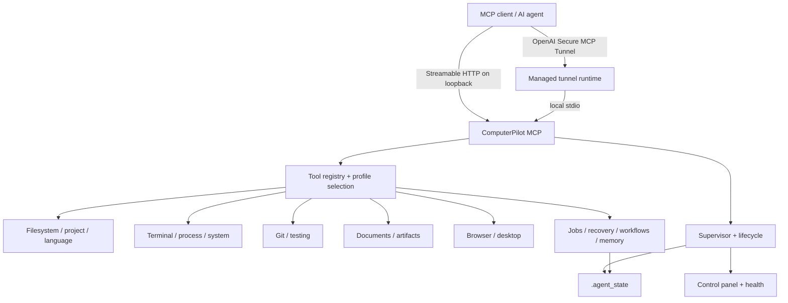

# Architecture

ComputerPilot MCP is a supervised local MCP runtime that combines typed developer/computer-use tools with durable jobs, explicit recovery, and platform capability detection.

Authoring contracts are in [native tool authoring](development/MCP-TOOL-AUTHORING.md), [extension authoring](development/MCP-EXTENSION-AUTHORING.md), and [testing standards](development/TESTING-STANDARDS.md). The [agent contract](../AGENTS.md) records the release handoff; the full master plan stays outside the repository. This architecture describes current runtime behavior until implementation evidence warrants an update.

## Runtime overview



## Tool registration

`core/registry.py` is the top-level MCP construction point.

It:

1. detects host capabilities;
2. resolves the requested tool profile;
3. removes unsupported domains;
4. registers typed domain tools;
5. adds domain discovery, recommendation, and health tools.

The public display title is **ComputerPilot MCP**. The protocol-level server identifier remains `ali_windows_agent_mcp` for compatibility with existing client/tunnel configuration.

## Adaptive execution router

`core/tool_catalog.py` is the shared execution metadata source for discovery enrichment, route planning, and workflow route checks. The live MCP registry remains the authority for availability: a catalog entry never makes an unregistered tool selectable.

`core/execution_router.py` is a pure decision layer:

```text
structured execution intent
    -> registered candidate generation
    -> platform/capability filtering
    -> hard safety constraints
    -> deterministic-v1 ranking
    -> explainable route decision
```

The router does not launch applications, take screenshots, execute commands, mutate files, or perform external probes while choosing a route. Candidate availability comes only from the registered tool names supplied by the current MCP server and the supplied platform capability snapshot.

The initial policy ranks valid candidates lexicographically by stronger determinism, recoverability, lower side-effect risk, capability confidence, lower cost/latency tiers, and stable route/tool tie-breakers. Hard constraints run first and cannot be overridden by ranking. In particular, stale semantic references do not fall back to coordinates, destructive ambiguous semantic actions fail closed, raw desktop requires explicit permission and is forbidden for destructive fallback, and document fidelity constraints such as macro preservation eliminate routes that cannot prove them.

Public APIs are read-only `execution_candidates` and `execution_recommend`. The runtime deliberately has no universal `execution_run` dispatcher. `visual.desktop` is reserved but unavailable until the visual-grounding phase.

## Native read batching

`tools/filesystem/batch.py` reuses the contained native reader and durable resource admission for 1–16 independent text windows. Live SDK descriptor eligibility is rechecked after slot/claim waits and before dispatch. Four batches/four actual reads per server and source/text/SDK-response ceilings bound resources. Cancellation retains slots and claim connection ownership until actual I/O finishes; restart generations fence old cleanup. Only immutable Windows API declarations are reused; handles, path/reparse validation and source checks remain per read. The response makes no atomic snapshot claim. See [Batch contracts and measurements](tooling.md#opt-in-native-read-batching).

## Platform capability model

The runtime does not pretend every host provides identical features.

Portable domains include the shared filesystem/project/Git/testing/documents/jobs/recovery/workflow core. Platform adapters decide whether Windows-only capabilities such as native desktop input, UI Automation, `run_cmd`, services, and installed-software backends are registered.

Process ownership is intentionally implemented differently:

- Windows: Job Objects.
- Linux/macOS: dedicated sessions/process groups with bounded TERM/KILL escalation.

## Supervisor and lifecycle

The launchers start `scripts.bootstrap`, which validates the environment and then starts `scripts.supervisor`.

The supervisor owns runtime lifecycle concerns such as:

- start/restart/stop;
- health observation;
- bounded retry/backoff;
- mutation-aware drain before planned restarts;
- process cleanup;
- loopback control panel.

The runtime tracks lifecycle state so new mutations can be blocked while a controlled drain is in progress.

### Observability and local operations console

The Supervisor also owns the loopback operations surface at `http://127.0.0.1:8766/`. The panel is local-only and reads bounded, redacted state rather than exposing arbitrary shell/process control.

Its data model is split so frequent refreshes stay lightweight while detailed views are fetched on demand:

- summary/build/Git identity and runtime health;
- resource budgets, storage consumers, performance timing, capabilities, and safe configuration;
- transport diagnosis/history plus confirmed poll-stall recovery state;
- Recent Jobs with bounded incremental/downloadable output and guarded cancellation;
- Recent Operations with searchable/filterable audit metadata and full-target inspection;
- workflow, recovery, execution-routing, tool-activity, process, Doctor, and diagnostics views.

Generation-scoped runtime-health and tool-activity snapshots let the Supervisor observe the live MCP process without constructing a second MCP server. Audit/transport records are metadata-only and are bounded by retention/rotation settings.

## Durable jobs

Long-running commands can be moved out of a single MCP request.

Durable jobs persist state in SQLite and capture output on disk. The subsystem supports:

- idempotency keys;
- queue vs execution timeout separation;
- bounded admission control;
- independent workers;
- cancellation;
- restart survival;
- monotonic status versions;
- version-aware waiting;
- incremental output cursors.

The persistent job store, not one in-memory runtime object, is the source of truth.

## Recovery model

External side effects are not assumed to be replay-safe.

Standalone mutations use the operation recovery journal. Durable workflows maintain operation checkpoints and reconciliation intent in the workflow store.

If a runtime disappears after a side effect may have occurred but before the final outcome is known, the operation can remain `uncertain`. Document publication checkpoints its validated final file hash before the atomic replacement, so that crash window retains a reconciler-compatible postcondition.

Semantic UIA mutations checkpoint bounded numeric target identity before backend dispatch, using the same native journal for direct service and MCP calls. Their `prepared` / `may_dispatch` metadata survives restart and compaction without storing titles, control text or values. Once dispatch may have happened, a backend exception is an uncertain outcome rather than proof that no effect occurred. Identity metadata supports investigation; it does not automatically reconcile a private UI value. Existing native recovery opt-out remains explicit and still respects lifecycle drain.

Resolution paths are:

1. inspect durable evidence;
2. reconcile against an allowlisted postcondition;
3. explicitly acknowledge an operator conclusion if evidence cannot decide.

The system deliberately does not blind-retry arbitrary ambiguous shell/process effects.

## Durable workflows

Workflows persist:

- exact execution definitions;
- aggregate and step state;
- operation checkpoints;
- optimistic versions;
- leases;
- events;
- cancellation;
- reconciliation evidence;
- optional structured execution intent;
- selected execution route and router policy version;
- compact route decision metadata and bounded fallback history.

For routed steps, the route decision is persisted before the operation enters the side-effect path and must match the fixed allowlisted workflow action route. A safe retry may record a capability-driven route change before a new side effect, but an uncertain operation is never rerouted or replayed until reconciliation conclusively resolves the existing effect.

Every in-process `WorkflowExecutor` caller must supply the keyword-only `route_planner`: use the shared `core.execution_router.build_route_planner` factory for callers accepting execution intents, or `core.workflows.NATIVE_ONLY_ROUTING` for callers that only submit steps without intents. Omission and `None` raise `TypeError` at construction. The explicit native-only mode rejects an intent-bearing step before action dispatch. The Router remains advisory, and external MCP workflow actions remain unsupported.

Workflow schema 9 adds an explicit, versioned dependency graph, fenced parallel-attempt ownership, durable resource requests/claims, and shared runtime-capacity admissions without changing legacy sequential execution identities. Sequential definitions continue to serialize with the pre-graph exact execution bytes and use implicit index-chain dependencies. DAG definitions use `execution_mode="dag"`, immutable `step_id` values and persisted dependency edges; readiness is derived from operation/admission state plus those edges rather than stored as a second authority. The executor contains a bounded dependency-ready scheduler with a single workflow lease heartbeat, atomic active-admission rows, `attempt_token` fencing, and a durable `reserved -> prepared -> may_dispatch -> settled` barrier. Resource claims use canonical typed keys with read/write and exact/subtree conflict semantics, are acquired all-or-none in short SQLite transactions, and become quarantined rather than unlocked when a workflow lease is lost. Participating native patch, Git mutation, terminal-command and durable-job boundaries use the same authority; an internal execution capability lets nested workflow helpers reuse the parent's claim without exposing a client-supplied bypass. Ruff/mypy/pytest analyzer work also consumes a durable shared `analyzer` capacity budget across foreground, background-worker and workflow paths. This guarantee applies only to participating managed boundaries; external editors/processes are not kernel-fenced and existing SHA/Git preconditions remain authoritative near mutation. The public MCP/worker path shares the default-off MCP_WORKFLOW_DAG_ENABLED operator gate; focused internal tests can opt in explicitly. Enable operator execution only after same-version graph-wide recovery and ownership gates pass; disabling preserves queued work and unresolved evidence.

Nested managed calls validate the internal capability against the active SQLite request, exact owner token and parent read/write scope before reusing ownership. Durable workers validate before spawning, then pass the bounded capability through the reserved `COMPUTERPILOT_INTERNAL_RESOURCE_CAPABILITY` environment variable. Owned command processes and analyzer threads preserve the execution context; caller environment overrides cannot replace it. Standalone job resource authority is `workflows.sqlite3` beside its jobs database; an inherited capability selects the existing parent authority for resource and analyzer admission. Analyzer permits bind PID and creation time. Following confirmed owned-tree cleanup, a worker releases permits matching the process identities captured before termination, including Windows launcher descendants; incomplete cleanup retains permits. The capability is an internal bearer credential, not a public tool parameter or an OS sandbox. DAG verification rejects `ruff_fix=true` before persistence; legacy sequential verification retains its existing fix behavior.

Built-in plans include `implement_and_verify`, `safe_git_commit`, and `prepare_release`.

Workflow persistence is separate from durable job process state. Jobs own process completion/output; workflows own orchestration and operation lifecycle.

## Filesystem editing

Mutation tools use scoped resource locks so unrelated files can remain concurrent.

Editing primitives include:

- atomic whole-file write;
- exact replacement;
- anchored replacement;
- AST-selected Python function/class body edits;
- transactional unified patches;
- validation-and-rollback refactors.

Hash/version preconditions are available on operations where stale external edits matter.

## Native document adapters

The `documents` domain uses file-format libraries directly instead of automating desktop applications.

- Excel supports `.xlsx` and `.xlsm`, bounded workbook/range/search/formula/table reads, and guarded value/formula/sheet/table mutations.
- DOCX supports metadata/structure inspection, bounded paragraph/table reads and search, plus conservative paragraph/text/table-cell mutations.
- PDF supports metadata/page inspection, bounded text extraction, and deterministic creation from plain text or a limited Markdown subset.

Binary document mutations share a publication primitive: per-target in-process and inter-process locking, optional source SHA-256 preconditions, same-directory staging, format-specific validation, recoverable backups, an fsynced recovery postcondition checkpoint before publication, atomic replacement, and final hash/size verification. The result includes an artifact descriptor with path, SHA-256, byte size, and media type.

OOXML readers validate archive structure and bounded expansion before library parsing. Excel macro mutation is accepted only when the VBA project survives staged serialization byte-for-byte. DOCX intentionally refuses ambiguous formatting transformations and macro-enabled `.docm`; PDF creation does not claim arbitrary editing of existing PDFs.

## Project and language intelligence

Python project analysis maintains bounded version-aware metadata rather than re-parsing every unchanged file for every query.

The LSP layer supports bounded one-shot intelligence and recoverable workspace edits. Its default path uses the discovered `pyright-langserver --stdio` command. The seven read tools accept either typed `request` or legacy `params`, preserve existing result envelopes, and validate both through the same fixed-method boundary before dispatch. No public argument selects an arbitrary executable or method; code-action commands and filesystem resource operations are never executed.

Persistent support is opt-in through `MCP_LSP_PERSISTENT_ENABLED` (default false) and reviewed `MCP_LSP_PROVIDERS_CONFIG`. Each server owns one `LspSessionManager`; registration/listing/health are inert. The manager bounds native owners, preparation, queues, document versions/bytes, resource usage and restart attempts. One owner enters/exits each transport and session, and shutdown retains unresolved cleanup as quarantine. Timeout/cancellation retires possibly dispatched work without replay. The [recorded provider acceptance](development/REAL-LSP-PROVIDER-ACCEPTANCE-2026-10-26.md) additionally covers real Python/TypeScript/PHP providers on Windows; Linux/macOS real-provider execution remains unverified.

Workspace-edit plans require every touched file's SHA-256, strict UTF-16 positions and matching versions for versioned `documentChanges`. Persistent rename additionally requires every target's version and hash in its server snapshot: unopened targets absent from that snapshot fail closed with `lsp_result_stale`. Plans cap files at 100, edits at 1,000 and replacement UTF-8 at 2 MiB. Dry runs prepare without backups or writes. Shared native resource admission and locks protect the final precondition check; an enabled recovery journal and pinned, verified preimage backups precede durable `prepared`/`may_dispatch` checkpoints. Writes are atomic per file; rollback restores only this operation's byte-identical postimages. Crash/unknown/conflict outcomes preserve evidence and never replay the batch. Direct in-process application also requires recovery. Worker reuse of a parent's operation is explicit and bound in the owning task, so inherited child-task contexts cannot overwrite its evidence. Successful application invalidates Python/context caches and retires the workspace session. See the [language authoring contract](development/MCP-TOOL-AUTHORING.md#language-requests-and-workspace-edits) for compatibility, limits and errors.

Reserved workspace-edit backup publication and retention cleanup use the same interprocess lock; cleanup reads a validated recovery-journal snapshot after obtaining it. Cleanup is skipped when a configured journal is missing or when the canonical journal is corrupt or not configured. An invalid existing journal also blocks startup recovery and compaction, preserving its evidence for operator investigation. A newly configured journal does not permit retention until its first record exists. This coordination requires all processes sharing the backup directory to run code that honors the lock; older running processes must be drained before relying on it.

## Browser and desktop automation

Playwright browser sessions use isolated contexts. Compatible sessions can share browser processes, while session/pool budgets and idle eviction bound resource growth.

Windows can additionally expose:

- native desktop screenshots;
- mouse/keyboard input;
- semantic UI Automation.

These tools are capability-gated and are not registered on unsupported hosts.

## State ownership

Generated state is intentionally local and separated by responsibility.

| Store | Owns |
| --- | --- |
| job database + output | durable command lifecycle and stdout/stderr |
| workflow database | definitions, orchestration state, operations, leases, events |
| recovery journal | standalone mutation ambiguity/evidence |
| project memory | bounded advisory project facts |
| artifacts/backups/screenshots/search snapshots | bounded generated supporting data |
| document lock directory | hashed cross-process coordination tokens for document mutation targets |
| tunnel runtime cache | verified external Secure Tunnel runtime |

Project memory is advisory data, not execution authority or a policy override.

## Control plane vs workload

Health/status paths are designed to remain lighter than the workloads they observe. Runtime resource budgets cover browser sessions, jobs, caches, artifacts, backups, audit files, and history retention.

See [Configuration](configuration.md) for the exposed budget controls.

## External MCP extensions (v0.8)

ComputerPilot MCP v0.8 adds an extensibility and agent foundation enabling operators to attach external MCP servers over local bounded stdio.

### Key architecture boundaries

- **Lifecycle & Process Ownership**: A single `ExtensionLifecycleManager` manages configured providers. Each external provider process is entered and exited by exactly one connection owner task (`bounded_stdio_transport`). Native process ownership is strictly enforced: Windows Job Objects prevent child/grandchild process leaks, and POSIX process groups enforce tree termination. Abrupt root exits reap the entire process tree.
- **Catalog Discovery & Generations**: Discovery reads external tools via `MCPServer.list_tools` overrides without invoking provider RPC or spawning processes during registration, `--check`, or listing. Discovered tool catalogs are tracked by `CatalogGenerationTracker` with monotonic generation numbers. Provider schemas are validated against a strict offline subset (no network, depth/complexity bounded); the first accepted schema fingerprint is frozen across reconnects.
- **Execution Boundary & Isolation**: External calls execute via `ExtensionLifecycleManager.execute_guarded_call` with immutable admission leases. All calls return the standard Core `ExtensionResult` envelope (`ok`, `source_type='external_mcp'`, `extension_id`, `provider`, `tool`, `outcome`, `content`, `structured_content`, `truncated`, `limits`, `artifact`, `error`, `message`). Large outputs produce bounded previews with optional sanitized artifacts; credentials and split-stream leaks are scrubbed before any sink.
- **Mutation Durability & Uncertainty**: Trusted mutating tools operate under a two-stage checkpoint journal (`prepared` -> `may_dispatch`) using schema-1 operation journals. Unresolved external operations are bounded by quota (128 max). If a crash, timeout, or lost response occurs after `may_dispatch`, the operation is marked `uncertain` with no automatic replay. Manual resolution is supported via inspection and acknowledgement APIs.
- **Advisory Routing**: The Adaptive Execution Router considers `external.mcp` candidates when operator intent mappings match, bounding determinism at 4 and prioritizing native determinism 5 on ties. Router recommendations remain strictly advisory.
- **Observability**: Health and loopback panel projections read cached state with zero provider RPC. Bounded telemetry tracks the last 64 call outcomes per owner without per-provider dynamic labels.

For authoring and contract details, see [External MCP extension authoring](development/MCP-EXTENSION-AUTHORING.md) and [Configuration](configuration.md).

## Shared resource admission and DAG recovery

Native file writes, surgical edits, copy/move/delete, document publication, and LSP workspace edits join durable resource admission before local locks. Directory removal and moves use subtree claims; command-backed refactors reserve exclusive host coordination. Paths are revalidated after admission so alias changes while waiting fail before mutation. Background processes started outside the durable job/managed foreground interfaces remain outside this cooperative guarantee, as do editors and other external writers.

Workflow schema 10 links runtime capacity to parent resource requests with a nullable indexed foreign key. Cleanup uncertainty preserves both fences; a parent cannot release while a linked permit is unresolved, including when recording quarantine fails. Migration retains all existing capacity rows and quarantines active resource claims when legacy unlinked permits remain. These records require reconciliation, never expiry-based unlocking.

Workflow schema 11 stores a fingerprint of shared job, analyzer, workflow-step and per-workflow budgets on the existing resource request. Admission waits behind active or older pending requests with incompatible policy, including disjoint paths; compatible readers still overlap. Inherited dispatch and capacity require the same fingerprint. SQLite triggers reject legacy clients that omit policy or activate incompatible ownership. Migration quarantines active claims with unknown policy, releases only undispatched pending claims, and preserves capacity and workflow history. Budget changes therefore require draining or reconciling existing ownership, never silently expanding a live capability.

Windows owned-process cleanup confirms zero active processes through [Job Object accounting](https://learn.microsoft.com/windows/win32/api/winnt/ns-winnt-jobobject_basic_accounting_information) before releasing its native handle. Inspection/termination/close failure remains unresolved; process-table snapshots do not authorize killing a PID outside the Job Object. This includes descendants that outlive the original root process.

Native resource capabilities also bind their process owner PID and creation time. Recovery inspects each unique native identity outside the write transaction, then conditionally quarantines active claims or releases pending requests that never dispatched. Dead/reused/zombie or uninspectable identities cannot admit new nested work; active effects remain fenced until recorded resolution.

Windows ownership cleanup also waits on the captured root process handle within the same cleanup deadline. Zero Job Object accounting alone does not complete that root-handle check; an unsuccessful wait preserves the unresolved cleanup fence.

Cleanup uncertainty quarantines managed ownership regardless of the caller's general error policy. If quarantine storage fails, bounded cleanup uncertainty propagates through inherited contexts and the original active fence remains. After successful native job cleanup, resource-bound analyzer owners are checked by PID and creation time even when the root already exited and descendants were reparented. Only positively dead identities are reclaimed; live ancestors and uninspectable owners keep their permits. A reserved/prepared retry can settle its own pre-dispatch failure or cancellation without replay or leaving an active admission.

On Windows, a retained process handle may outlive execution while its PID remains visible. Capacity cleanup pins a synchronization handle, rechecks creation time, and requires a signaled exit or positive identity disappearance before releasing that owner. Denied or unknown probes retain capacity. Managed resource-context finalization must succeed before a durable job publishes success; unresolved child ownership reports bounded cleanup failure with the original fence preserved.

Managed Git mutations reserve exclusive host coordination because hooks and filters can affect paths outside the repository. Workflow mutations use native owned-process cleanup before returning. Local Git reads, intent preparation, reconciliation, and test selection share command policy that disables fsmonitor commands, implicit signature verification, external diff/textconv, automatic maintenance, and on-demand transport. Missing local objects produce a bounded failure; these interfaces do not implicitly fetch. Explicit terminal commands retain their existing behavior.

DAG restart recovery scans every operation under one write transaction. Reserved/prepared attempts require no child reference or unresolved child capacity before returning to a safe pending state. Possible dispatch remains uncertain with its admission retained; completed evidence repairs step projections without execution. Resolving one operation recomputes the aggregate from every sibling. Queue transitions independently reject unresolved branches, resource ownership, admissions, and failed effectful operations without no-dispatch evidence.

DAG cancellation stops admission and signals cooperative branches while deferred branches publish their bounded results. Possible partial effects take precedence over cancellation. Intent preparation, action execution, Git follow-up reads, affected-test selection, and postconditions consume remaining deadlines. `check_file` content checks use chunked UTF-8 reads, overlapping substring matching, and a source-byte admission limit of four times `MCP_MAX_FILE_WRITE_CHARS`; oversized inputs now fail explicitly. Automatic retries require descriptor `transient` plus known read-safe failure evidence; `max_retries` cannot override `never`.

Job schema 4 adds a durable pre-spawn dispatch phase. Worker identity, cancellation, and the pending phase are checked atomically immediately before spawn, using the worker's existing connection. Older rows retain a `legacy` phase until a queued job is claimed; migration preserves history. A managed idempotent submit cannot recreate a job lost during a retention race. Public DAG execution defaults off; operator activation requires complete same-version G6 evidence.
